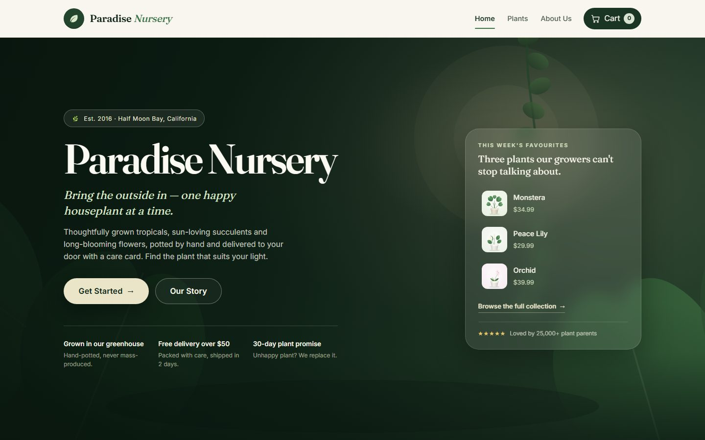
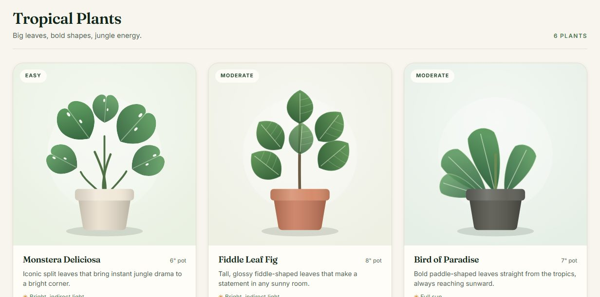
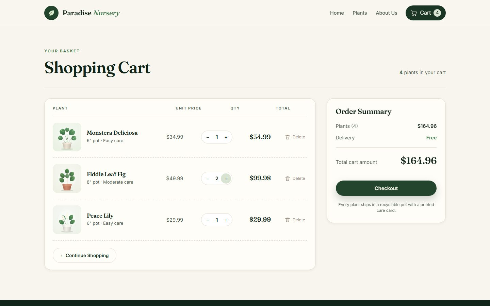
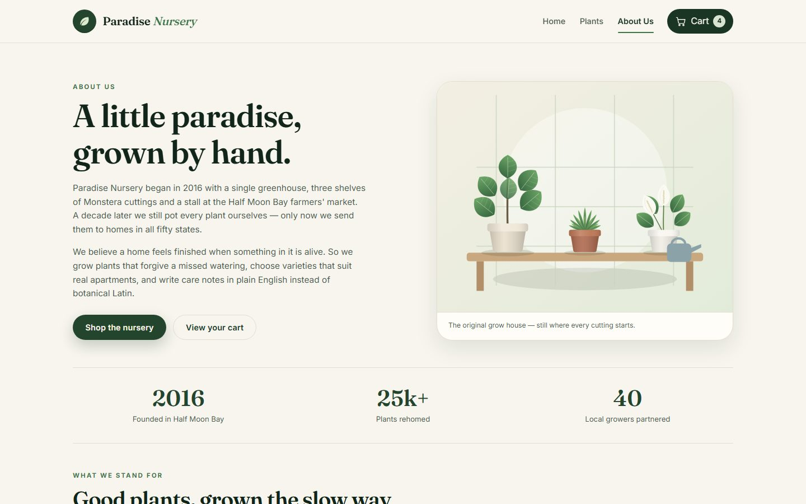

# Paradise Nursery — Shopping Cart Application

A dynamic, single-page shopping cart built for **Paradise Nursery**, an online
houseplant shop. Customers browse nursery-grown plants by category, read the
details of each plant, add them to a Redux-powered cart and manage quantities,
line totals and the overall basket total before checking out.

> **Project name:** Paradise Nursery — Shopping Cart Application
>
> **Type:** React single-page e-commerce demo (final course project)
>
> **Stack:** React 19 · Vite · Redux Toolkit · React Router

---

## Table of contents

- [About the project](#about-the-project)
- [Preview](#preview)
- [Features](#features)
- [Tech stack](#tech-stack)
- [Getting started](#getting-started)
- [Project structure](#project-structure)
- [Routes and pages](#routes-and-pages)
- [How the cart works](#how-the-cart-works)
- [Design notes](#design-notes)

---

## About the project

Paradise Nursery is a fictional plant nursery in Half Moon Bay, California.
This project recreates its storefront as a client-side React application:

- a landing page that introduces the nursery,
- a product listing with **18 houseplants in 3 categories** (six per category),
- a shopping cart with live item counts, quantities and totals.

There is no backend — the cart lives in Redux state for the duration of the
session, which keeps the focus on component composition, state management and
routing.

## Preview

**Landing page**



**Product listing — six plants per category**



**Shopping cart**



**About Us**



## Features

### Landing page

- Full-screen background image (see `.landing` in `src/App.css`).
- Company name, introduction, "Get Started" button and a "favourites" panel.
- Navigation bar shared by every page.

### Product listing (`/plants`)

- 18 unique plants grouped into **Tropical Plants**, **Succulents & Cacti** and
  **Flowering Plants** — six plants per category.
- Every card shows a thumbnail, name, pot size, description, light requirement,
  care level and price.
- "Add to Cart" adds the plant to the cart, **disables** itself ("Added") and
  increments the cart badge in the navbar.
- Quick-jump category chips and a confirmation toast.

### Shopping cart (`/cart`)

- Total number of plants and the **total cart amount**.
- Per-plant line totals (unit price × quantity).
- Thumbnail, name, unit price and pot size for every plant.
- `+` / `−` buttons that recalculate quantities and totals; removing the last
  unit removes the line.
- A delete button for every plant.
- "Checkout" button that shows a "Coming Soon!" message.
- "Continue Shopping" button that links back to the product listing.
- A friendly empty-cart state when nothing has been added yet.

### About Us (`/about`)

- Company story, founding year, values and visiting details (address, hours,
  email, phone).

## Tech stack

| Layer     | Choice                                  |
| --------- | --------------------------------------- |
| UI        | React 19 (function components + hooks)  |
| Build     | Vite 8                                  |
| State     | Redux Toolkit + React Redux             |
| Routing   | React Router 7                          |
| Styling   | Hand-written CSS (`App.css`, `index.css`) |
| Artwork   | Original SVG illustrations              |

## Getting started

```bash
# install dependencies
npm install

# start the dev server (http://localhost:5173)
npm run dev

# production build
npm run build

# preview the production build
npm run preview
```

The app has no environment variables or external services; `npm install` and
`npm run dev` are all that is needed.

## Project structure

```
paradise-nursery/
├── index.html
├── package.json
├── vite.config.js
├── docs/                        # screenshots used in this README
└── src/
    ├── main.jsx                  # React root, Redux Provider and Router
    ├── App.jsx                   # landing page, routes and footer
    ├── App.css                   # all component styles (incl. landing background)
    ├── index.css                 # design tokens and base styles
    ├── assets/
    │   ├── hero-bg.svg           # landing page background
    │   ├── story.svg             # About Us illustration
    │   └── plants/               # 18 plant thumbnail illustrations
    ├── components/
    │   ├── Navbar.jsx            # Home / Plants / About / Cart + item count
    │   ├── ProductList.jsx       # product listing grouped by category
    │   ├── CartItem.jsx          # shopping cart page
    │   └── AboutUs.jsx           # company details
    ├── data/
    │   └── plants.js             # plant catalogue and categories
    ├── redux/
    │   ├── CartSlice.jsx         # cart slice: reducers, actions, selectors
    │   └── store.js              # Redux store
    └── utils/
        └── formatPrice.js        # currency formatting helper
```

## Routes and pages

| Route     | Component     | Purpose                                        |
| --------- | ------------- | ---------------------------------------------- |
| `/`       | `LandingPage` | Company name, intro and "Get Started" button   |
| `/plants` | `ProductList` | 18 plants in 3 categories with Add to Cart     |
| `/cart`   | `CartItem`    | Cart lines, quantities, totals and checkout    |
| `/about`  | `AboutUs`     | Company story, values and visit information    |
| `*`       | `NotFound`    | Friendly 404 page                              |

The navbar is rendered above the routes, so it is present on the product
listing and cart pages (and everywhere else). The cart badge reads
`state.cart.totalQuantity`, so it updates the moment a plant is added.

## How the cart works

`src/redux/CartSlice.jsx` owns the entire cart:

```js
initialState = {
  items: [],          // { id, name, price, image, potSize, care, quantity, totalPrice }
  totalQuantity: 0,   // number of individual plants
  totalAmount: 0,     // price of everything in the basket
};
```

Actions:

| Action             | What it does                                              |
| ------------------ | --------------------------------------------------------- |
| `addToCart(plant)` | Adds a new line (ignores duplicates) and updates totals   |
| `increaseQuantity(id)` | `quantity + 1`, line total and cart total updated     |
| `decreaseQuantity(id)` | `quantity − 1`, or removes the line at quantity 1     |
| `removeFromCart(id)`   | Deletes the line and subtracts its cost               |
| `clearCart()`          | Empties the cart                                      |

Selectors `selectCartItems`, `selectTotalQuantity` and `selectTotalAmount` keep
components free of derived-state maths.

## Design notes

- Palette: deep greenhouse green, warm cream and terracotta.
- Type: *Fraunces* for headings, *Inter* for body copy (Google Fonts, with
  system fallbacks).
- All 18 plant thumbnails, the landing background and the About Us illustration
  are **original SVG artwork** included in the repository, so the project has
  no external image dependencies and nothing to break.
- Layouts are responsive from large desktop down to a 390 px phone, with a
  two-row navigation bar on small screens.
- Interactive elements have focus styles, `aria-label`s and live regions for
  quantity changes and toasts.

## Credits

Product names and copy are fictional and written for this course project.
Illustrations were generated for Paradise Nursery and are free to use with the
project.
